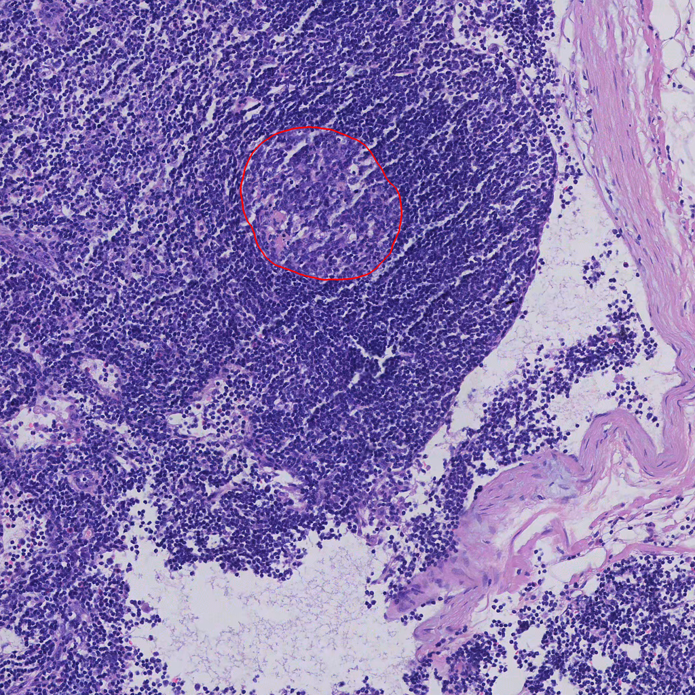
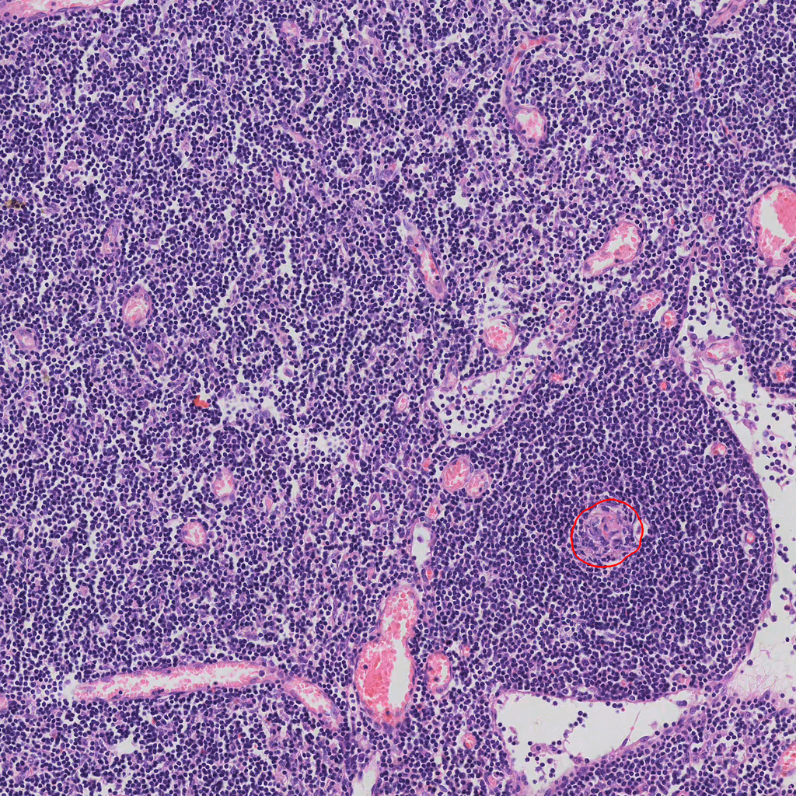

# LIMA

## Project introduction

LIMA (Lymph Node Immune and Metastasis Assessment) is a computational pathology framework for lymph node analysis. It combines lymph node segmentation, metastasis classification, and germinal center quantification.

## Available code

This release provides a standalone demo for single-image germinal center instance segmentation and a pretrained model package. Full pipeline code will be released separately.

## Installation and model preparation

Install the dependencies from the repository root:

```bash
python -m pip install -r requirements.txt
```

Download [demo.zip](https://github.com/CheJRung/LN-Assessment/releases/download/v0.1.0/demo.zip), place it in the repository root, and extract it:

```bash
python -m zipfile -e demo.zip .
```

The package contains the model checkpoint and preprocessing configuration:

```text
best/
├── config.json
├── preprocessor_config.json
└── model.safetensors
```

Use `--model` to specify another local checkpoint directory.

## Usage

Run an example with the default model directory:

```bash
python demo.py examples/inputs/1.png
```

Specify a model directory and output path:

```bash
python demo.py examples/inputs/2.png --model path/to/checkpoint --output demo_outputs/2.png
```

<table>
  <thead>
    <tr><th width="50%">Input</th><th width="50%">Prediction</th></tr>
  </thead>
  <tbody>
    <tr>
      <td width="50%"><a href="examples/inputs/1.png"></a></td>
      <td width="50%"><a href="examples/outputs/1.png"></a></td>
    </tr>
    <tr>
      <td width="50%"><a href="examples/inputs/2.png"></a></td>
      <td width="50%"><a href="examples/outputs/2.png"></a></td>
    </tr>
  </tbody>
</table>
